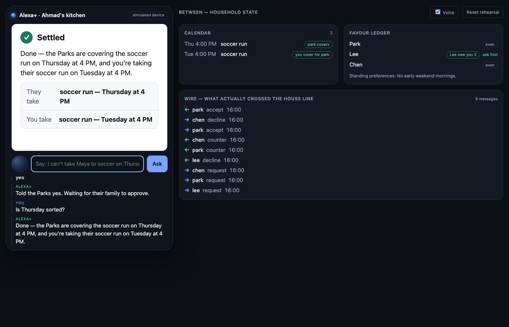
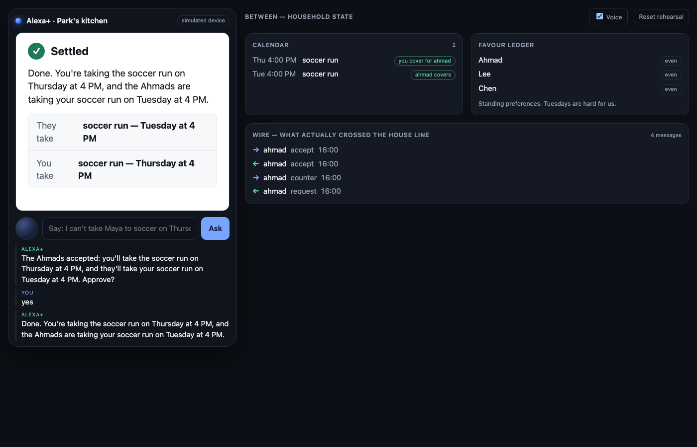

# Between

**A household assistant that negotiates childcare cover with other households' assistants.**

Between assigns each household an assistant with a single responsibility: arranging cover for
commitments such as school runs and club activities. A parent states a need, for example
*"I can't take Maya to soccer on Thursday."* The assistant identifies which trusted households
may be able to help, negotiates an equitable exchange with their assistants, and returns a
single proposal for approval. All data exchanged between households consists of signed,
schema-validated offers; calendars and personal details never leave the household.

Between was developed for the Alexa+ track of the Build, Ship, Shape: Amazon Developer
Hackathon. Development began on 10 October 2026.

---

## Contents

1. [Demonstration scenario](#demonstration-scenario)
2. [Architecture](#architecture)
3. [Getting started](#getting-started)
4. [Hosted deployment](#hosted-deployment)
5. [Implementation status](#implementation-status)
6. [Repository structure](#repository-structure)
7. [Security and privacy](#security-and-privacy)
8. [Documentation](#documentation)
9. [Licence](#licence)

## Demonstration scenario

The demonstration involves four households (Ahmad, Park, Lee and Chen) and a single
scheduling conflict.

1. **Request.** The Ahmad household asks: *"I can't take Maya to soccer on Thursday. Can you
   sort it out?"* The assistant displays a negotiation feed showing that three households have
   been contacted.
2. **Negotiation.** The Lee household's assistant declines without giving a reason, because no
   household may inspect another's calendar. The Park household counters with a swap, and the
   Chen household offers an unconditional favour. The Park offer is selected on the basis of
   the Ahmad household's own favour ledger.
3. **Approval.** Each household receives one proposal card: *the Parks take Thursday; the
   Ahmads take Tuesday.* Each family approves by voice or on the card. No agreement exists
   until both families have approved.
4. **Settlement.** Both calendars and both ledgers are updated. The wire panel lists every
   message exchanged between the households: signed offers only, containing no event titles,
   names or locations.

The two households at the moment of settlement, captured through the hosted deployment:

| Ahmad household | Park household |
|---|---|
|  |  |

## Architecture

```
        Ahmad household              Park household (likewise Lee, Chen)
 ┌───────────────────────────┐   ┌───────────────────────────┐
 │  MCP server  (4 tools)    │   │  MCP server  (4 tools)    │
 │  ▼                        │   │                        ▲  │
 │  negotiation engine       │   │       negotiation engine  │
 │  ├ calendar (private)     │   │       calendar (private)  │
 │  ├ favour ledger (private)│   │       favour ledger       │
 │  └ threads / offers       │   │       threads / offers    │
 │        │                  │   │              │            │
 │        └── signed offers ─┼──►│  POST /peer/offers        │
 │  SQLite (one file)        │◄──┼── signed offers           │
 └───────────────────────────┘   └───────────────────────────┘
        ▲ MCP over HTTP                  ▲ MCP over HTTP
        │                                │
   Alexa+ (or the simulator page)   Alexa+ (or the simulator)
   renders the MCP App view          renders the MCP App view
```

- **Assistant interface.** Each household exposes an MCP server with four tools
  (`find_help`, `negotiation_status`, `respond_to_proposal` and `ledger`) and a `ui://` app
  resource, which allows the assistant to render interactive cards rather than plain text.
- **Inter-household protocol.** Households communicate exclusively through offers defined by
  [`between-protocol`](packages/protocol): a strict Zod schema, Ed25519 signatures over the raw
  request bytes, mandatory expiry, a ±5-minute clock-skew tolerance and a limit of three
  counter-offers per thread. Unknown fields are rejected, so an offer cannot carry calendar
  data.
- **Deterministic negotiation engine.** The engine contacts households in order of outstanding
  favours, ranks candidate moves (unconditional favours before swaps, lowest cost first, with
  reference to the ledger) and applies a bounded next-move protocol when a swap is not
  acceptable. An optional chooser backed by Claude on Amazon Bedrock may select among moves the
  engine has already determined to be legal; it cannot introduce new moves. With
  `CHOOSER=rules` (the default) the system has no cloud dependency.
- **Two-sided, idempotent commitment.** An agreement is committed only after both households
  approve, and the commit to calendar and ledger is safe to replay.

## Getting started

**Prerequisites:** Node.js 24 or later and npm. No accounts, credentials or cloud services are
required.

```sh
npm install
npm run build      # build the MCP App view and the simulator page
npm test           # protocol, engine, MCP interface and failure-mode tests
npm run e2e        # four servers exchanging signed offers over HTTP

npx playwright install chromium   # required once for the browser test suites
npm run ui         # both households in a real browser: cards, controls, panels
npm run hosted     # the same pages served under path prefixes, as in the hosted deployment

npm run dev        # start ahmad (4001), park (4002), lee (4003) and chen (4004)
npm run host       # as dev, plus a single public ngrok URL for both households
```

After `npm run dev`, open the simulated Alexa+ device for each household:

- Ahmad household: <http://127.0.0.1:4001/sim/>
- Park household: <http://127.0.0.1:4002/sim/>

Enter or speak *"I can't take Maya to soccer on Thursday"* in the Ahmad window. The Park window
announces the proposal when it arrives. Each page includes side panels for the household
calendar, the favour ledger and the raw wire log; every message on the wire is a
schema-valid signed offer.

### Configuration

| Variable | Purpose |
|---|---|
| `DEMO_NOW` | Fixes the current time (for example `2026-10-17T09:00:00-07:00`) so that seed data, tests and recordings are reproducible. |
| `PACE_MS` | Delays agent replies (for example `1200`) so that the negotiation can be followed in real time. |
| `CHOOSER` | `rules` (default) or `claude` to enable the Amazon Bedrock chooser. |

The complete list of settings is documented in [`.env.example`](.env.example).

## Hosted deployment

`npm run host` makes the demonstration available at a single public URL. A free ngrok account
provides one reserved domain, and a second tunnel would compete for it. The router in
[`scripts/router.ts`](scripts/router.ts) therefore serves each household under its own path
behind one tunnel:

- `https://<domain>/ahmad/sim/`: Ahmad household
- `https://<domain>/park/sim/`: Park household

The script prints these links and writes them, together with reset commands, to
`data/hosted-links.txt` for inclusion in the submission's testing instructions. The deployment
runs on the host machine, which must remain powered on with the terminal open throughout the
judging period. On first visit, ngrok's free tier displays an interstitial page that requires
one click; command-line requests are unaffected. A named Cloudflare tunnel on a custom domain
avoids the interstitial.

## Implementation status

| Component | Status |
|---|---|
| MCP server, tools and app view | **Implemented.** Driven by an MCP host; the simulator communicates with the same server over HTTP. |
| Offer protocol, signatures and state machine | **Implemented.** Published separately as [`between-protocol`](packages/protocol) with its own test suite. |
| Negotiation engine, calendar and ledger | **Implemented.** One SQLite database per household, kept consistent through signed messages. |
| Alexa+ device | **Simulated.** The Alexa+ MCP toolkit is a US-only developer preview restricted to the developer's account; the simulator hosts the real MCP App through the ext-apps app bridge. |
| Claude on Amazon Bedrock chooser | **Optional.** Disabled by default (`CHOOSER=rules`); it ranks only moves already determined to be legal. |

## Repository structure

```
src/                    household server: engine, protocol transport, MCP, simulator backend
web/app/                MCP App view (negotiation feed, proposal, settlement, ledger)
web/sim/                simulated Alexa+ page (device, transcript, panels)
packages/protocol/      between-protocol: schema, signing, thread state machine
scripts/dev.ts          runs the four local households
scripts/host.ts         dev servers, ngrok and the router, for hosted judging
scripts/router.ts       path-based routing of one public URL to each household
test/                   protocol, engine, MCP interface, four-server end-to-end and simulator tests
                        (test/ui.test.ts and test/hosted.test.ts drive a real browser)
docs/                   product specification, demo runbook and hackathon submission material
```

## Security and privacy

- Only offers cross between households, and an offer contains only a task label, a start time
  and a duration.
- A declined request discloses nothing: neither the reason nor the conflicting commitment.
- No agreement is made on a household's behalf; both households must approve explicitly.
- The engine executes only moves it has generated itself. The chooser may rank moves but cannot
  create them. An unrecognised request produces a spoken clarification rather than a calendar
  change.

## Documentation

An index of all project documentation is available in [`docs/README.md`](docs/README.md). The
wire protocol is specified in [`packages/protocol/SPEC.md`](packages/protocol/SPEC.md).

## Licence

Released under the MIT Licence. See [`LICENSE`](LICENSE).
